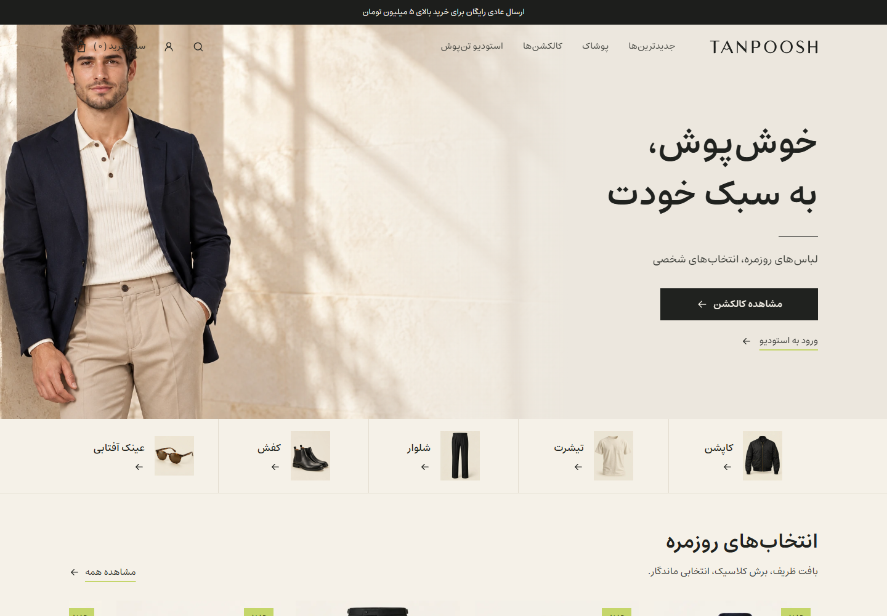
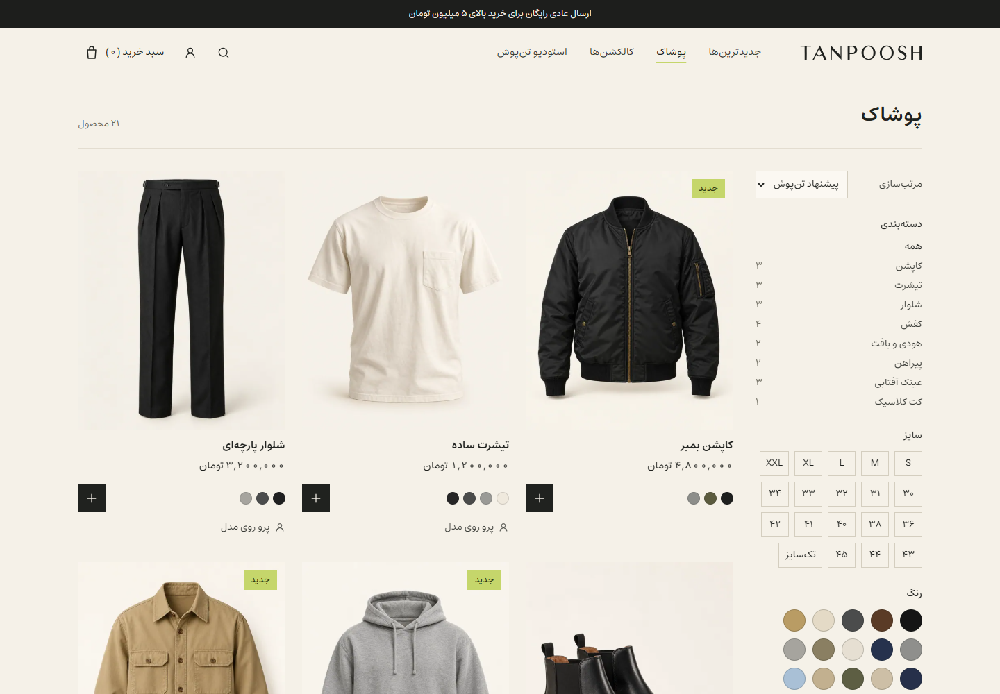
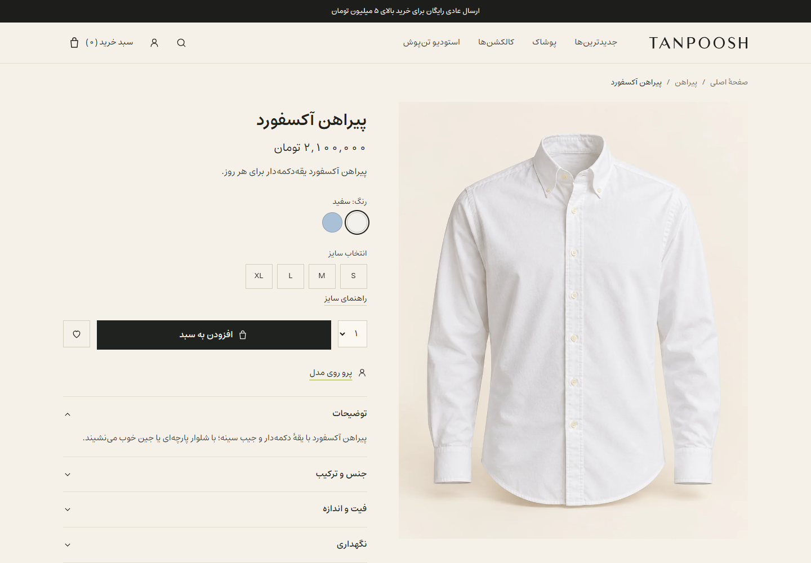
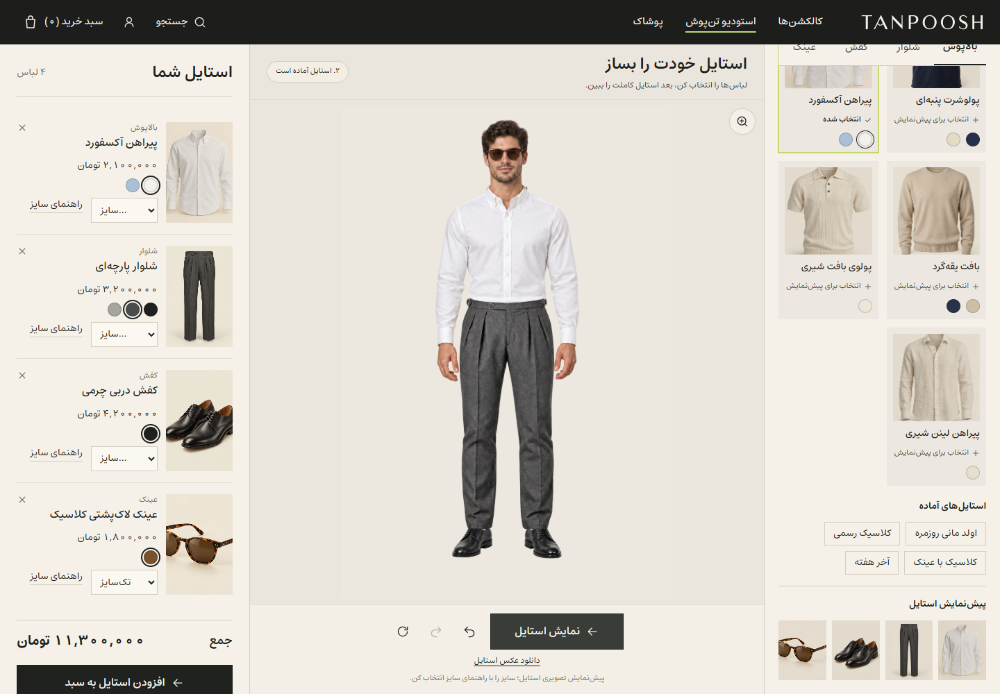
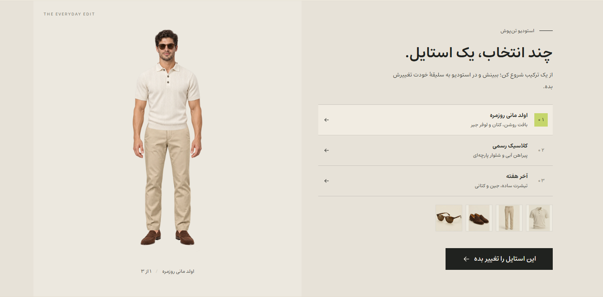
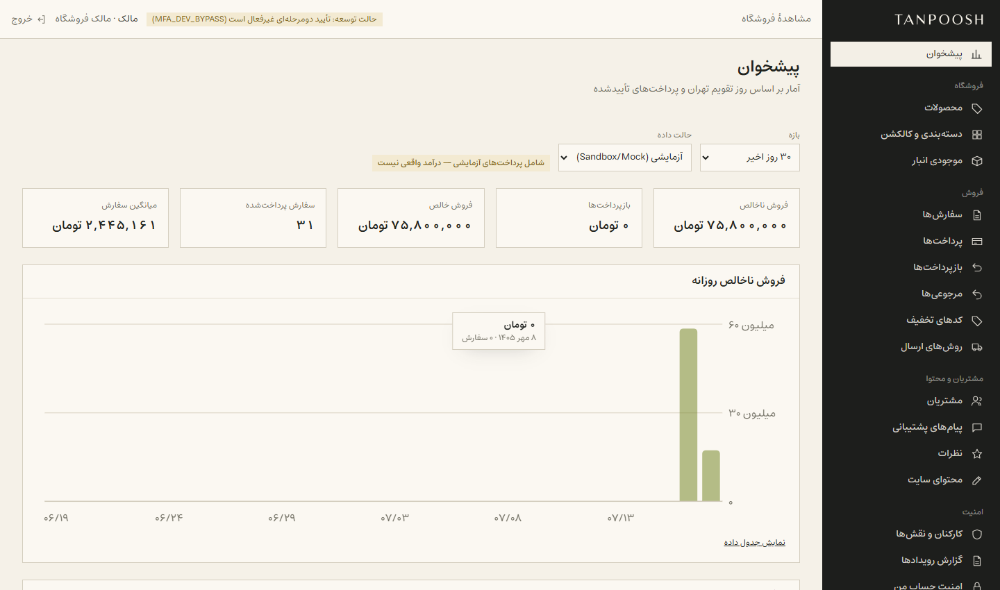
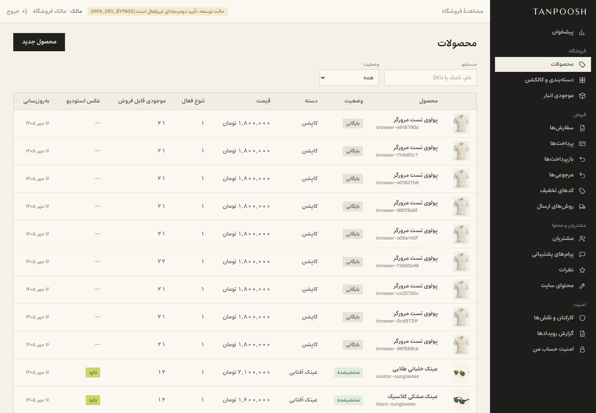
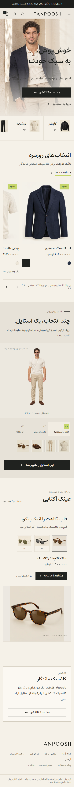
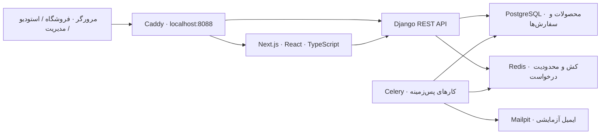

<div align="center">


# تن‌پوش · فروشگاه و استودیوی استایل

**از انتخاب لباس تا دیدن یک استایل کامل؛ در یک فروشگاه فارسی و راست‌چین.**


[نمایش تصویری](#gallery) · [استودیوی استایل](#studio) · [امکانات](#features) · [شروع سریع](#getting-started) · [معماری](#architecture) · [بررسی پروژه](#checks)



</div>

تن‌پوش یک پروژهٔ کامل فروشگاه پوشاک مردانه با رابط فارسی، قیمت‌های تومانی و طراحی واکنش‌گراست. محصولات را مرور کنید، رنگ و سایز انتخاب کنید، لباس‌ها را در استودیوی استایل کنار هم ببینید و ست انتخابی را به سبد خرید اضافه کنید. پنل اختصاصی مدیریت هم برای محصولات، موجودی، سفارش‌ها و محتوای فروشگاه در دسترس است.

> تصاویر این README از اجرای واقعی برنامه گرفته شده‌اند. داده‌ها و تصاویر محصولات نمایشی‌اند؛ پرداخت در حالت محلی شبیه‌سازی می‌شود و ایمیل‌ها به Mailpit می‌روند.

| خرید | ساخت استایل | مدیریت |
|---|---|---|
| کاتالوگ، جست‌وجو، فیلتر، رنگ و سایز، سبد و سفارش | ۱۷ محصول، ۳۱ انتخاب رنگ و ۲٬۵۲۰ ترکیب | نقش‌ها و مجوزها، موجودی، سفارش، گزارش و محتوا |

<a id="gallery"></a>
## نمایش تصویری پروژه

برای دیدن جزئیات روی تصویرها کلیک کنید.

### فروشگاه؛ از ویترین تا انتخاب محصول

| کاتالوگ و فیلترها | جزئیات محصول |
|---|---|
| [](docs/screenshots/shop.png) | [](docs/screenshots/product.png) |
| کارت‌های محصول، دسته‌بندی و مرتب‌سازی | عکس محصول، انتخاب رنگ، سایز و افزودن به سبد |

<a id="studio"></a>
### استودیوی استایل؛ لباس‌ها را کنار هم ببینید



یک بالاپوش، شلوار و کفش انتخاب کنید؛ عینک را هم در صورت تمایل اضافه کنید. با «نمایش استایل»، نتیجه روی یک مدل خیالی ثابت نمایش داده می‌شود. تغییر رنگ یا محصول به پیش‌نمایش تازه نیاز دارد؛ سایز برای انتخاب موجودی است و فرم بدن را شبیه‌سازی نمی‌کند.

- ترکیب عکس‌های آماده با دوربین، ژست و نور ثابت؛ پیش‌نمایش بدون کلید API یا تولید آنلاین تصویر.
- انتخاب رنگ و سایز، قیمت کل ست و افزودن یک‌جای لباس‌های انتخابی به سبد.
- پیشنهادهای آماده، واگرد و ازنو، بزرگ‌نمایی و دریافت تصویر JPEG.
- ذخیره و اشتراک‌گذاری استایل‌ها و بازکردن دوبارهٔ انتخاب‌ها.

| بخش | انتخاب‌های محصول و رنگ |
|---|---:|
| بالاپوش | ۱۵ |
| شلوار | ۷ |
| کفش | ۶ |
| عینک | ۳ + بدون عینک |
| ترکیب‌ها | **۱۵ × ۷ × ۶ × ۴ = ۲٬۵۲۰** |

استودیو از لایه‌های دوبعدی عکس استفاده می‌کند. پیش‌نمایش و خروجی JPEG از هندسه و ترتیب لایهٔ مشترک استفاده می‌کنند. لباس‌های رویی در فروشگاه فروخته می‌شوند و در استودیو حضور ندارند. جزئیات فنی در [راهنمای تصاویر استودیو](docs/STUDIO_IMAGES.md) آمده است.

### پیشنهادهای تعاملی در صفحهٔ اصلی



بین ست‌های آماده جابه‌جا شوید، لباس‌های هر ست را ببینید و همان انتخاب را برای شخصی‌سازی در استودیو باز کنید.

### پنل مدیریت؛ عملیات فروشگاه در یک محیط فارسی

| داشبورد مدیریت | مدیریت محصولات |
|---|---|
| [](docs/screenshots/admin.png) | [](docs/screenshots/admin-products.png) |
| آمار پرداخت‌های آزمایشی و دسترسی به بخش‌های مدیریتی | جست‌وجو، مشاهده و ویرایش کاتالوگ |

### تجربهٔ موبایل

<details>
<summary>دیدن صفحهٔ اصلی در نمایشگر موبایل</summary>
<br />

</details>

<a id="features"></a>
## امکانات اصلی

| بخش | امکانات |
|---|---|
| ویترین | مجموعه‌ها، محصولات پیشنهادی، ریل افقی محصولات و پیشنهادهای استایل |
| کاتالوگ | جست‌وجو و فیلتر، انتخاب رنگ و سایز، عکس و موجودی هر تنوع |
| خرید | سبد مهمان و مشتری، ادغام سبد پس از ورود، کد تخفیف و روش ارسال |
| سفارش | رزرو موجودی، پرداخت آزمایشی، تلاش مجدد پرداخت و پیگیری سفارش |
| حساب کاربری | آدرس‌ها، علاقه‌مندی‌ها، سفارش‌ها، استایل‌های ذخیره‌شده و درخواست مرجوعی |
| مدیریت | محصولات، دسته‌بندی، موجودی، سفارش، مرجوعی، پرداخت و بازپرداخت |
| عملیات فروشگاه | کوپن، ارسال، مشتریان، کارکنان، نقدها، پشتیبانی، محتوا و تنظیمات |
| دسترسی | نقش‌های مالک، مدیر کاتالوگ، مدیر سفارش و مالی؛ ثبت رویدادهای مدیریتی |
| رابط | فارسی و راست‌چین، فونت Estedad، طراحی واکنش‌گرا و پیام‌های خطای فارسی |

<a id="getting-started"></a>
## شروع سریع

### اجرای پروژهٔ آماده در ویندوز

پس از نصب وابستگی‌ها و آماده‌سازی سرویس‌های محلی، روی **`START_TANPOOSH.cmd`** دوبار کلیک کنید یا از ریشهٔ پروژه اجرا کنید:

```powershell
powershell -NoProfile -ExecutionPolicy Bypass -File tools/start-local.ps1 -OpenBrowser
```

| مسیر | کاربرد |
|---|---|
| `http://localhost:8088` | فروشگاه |
| `http://localhost:8088/studio` | استودیوی استایل |
| `http://localhost:8088/manage/login` | ورود مدیر |
| `http://127.0.0.1:8025` | صندوق ایمیل آزمایشی Mailpit |

### نصب از ابتدا

پیش‌نیازها: **Python 3.12، Node.js 24، PostgreSQL 18، Redis، Mailpit و Caddy**. لانچر ویندوز از ابزارهای قابل‌حمل در `.local-tools/` استفاده می‌کند؛ مسیر ابزارهای نصب‌شده روی سیستم خود را مطابق [راهنمای نصب](QUICKSTART.md) تنظیم کنید.

```powershell
git clone https://github.com/hamidshaikhy/tanpoosh.git
cd tanpoosh
py -3.12 -m venv backend/.venv
backend/.venv/Scripts/python.exe -m pip install -r backend/requirements-dev.txt
```

پایگاه دادهٔ `tanpoosh` و کاربر آن را بسازید و PostgreSQL، Redis و Mailpit را اجرا کنید. رمز پایگاه داده را در فایل محلی `.local-tools/pg-app-password.txt` قرار دهید. سپس:

```powershell
backend/.venv/Scripts/python.exe backend/scripts/init_local_env.py
backend/.venv/Scripts/python.exe backend/scripts/sync_frontend_env.py
backend/.venv/Scripts/python.exe backend/manage.py migrate
backend/.venv/Scripts/python.exe backend/manage.py seed_store
backend/.venv/Scripts/python.exe backend/manage.py refresh_demo_catalog
backend/.venv/Scripts/python.exe backend/manage.py bootstrap_owner --generate
cd frontend
npm ci
cd ..
powershell -NoProfile -ExecutionPolicy Bypass -File tools/start-local.ps1 -OpenBrowser
```

نام کاربری اولیهٔ مدیر `tanpoosh_admin` است. رمز ساخته‌شده در `backend/.local-credentials/owner.txt` ذخیره می‌شود؛ رمزها و فایل‌های `.env` در Git قرار نمی‌گیرند. برای تغییر رمز مدیر:

```powershell
backend/.venv/Scripts/python.exe backend/manage.py set_staff_password --username tanpoosh_admin
```

در اجرای محلی، ورود مدیر فقط با نام کاربری و رمز انجام می‌شود (`MFA_DEV_BYPASS=true`). با تنظیم این گزینه روی `false` می‌توان تأیید دومرحله‌ای را فعال کرد. تنظیمات production تأیید دومرحله‌ای را الزامی می‌کنند.

اجرای اختیاری با Docker Compose و توضیح سرویس‌ها در [راهنمای عملیات](docs/RUNBOOK.md) و [فایل Compose](docker-compose.yml) آمده است.

<a id="architecture"></a>
## معماری و فناوری‌ها



| لایه | فناوری |
|---|---|
| فرانت‌اند | Next.js App Router، React، TypeScript، Tailwind CSS |
| داده و وضعیت رابط | TanStack Query، Zustand، React Hook Form و Zod |
| API | Django و Django REST Framework، قرارداد OpenAPI |
| داده و پردازش | PostgreSQL، Redis و Celery |
| استودیو | لایه‌های WebP، SVG برای نمایش و Canvas2D برای خروجی |
| تست | pytest، Vitest و Playwright |
| سرویس‌های محلی | Caddy و Mailpit |

```text
backend/                 API، مدل‌ها، مجوزها، مهاجرت‌ها و تست‌ها
  fixtures/seed/         کاتالوگ و تصاویر اولیهٔ محصولات
frontend/
  src/app/               مسیرهای فروشگاه، حساب و مدیریت
  src/studio/            انتخاب لباس و ترکیب عکس‌های استایل
  src/manage/            رابط پنل مدیریت
  public/                نشان تجاری و تصاویر آمادهٔ استودیو
docs/                    معماری، عملیات و تصاویر README
infra/                   تنظیمات پراکسی
tools/                   اجرا، توقف و ابزارهای نگهداری
```

[معماری کامل](docs/ARCHITECTURE.md) · [عملیات و پشتیبان‌گیری](docs/RUNBOOK.md) · [منابع تصاویر و فونت](docs/ASSET_MANIFEST.md)

<a id="checks"></a>
## بررسی پروژه

از پوشهٔ `backend/`:

```powershell
.venv/Scripts/python.exe -m pytest -q
.venv/Scripts/python.exe -m ruff check apps tests config scripts
.venv/Scripts/python.exe manage.py makemigrations --check --dry-run
```

از پوشهٔ `frontend/`:

```powershell
npm run lint
npm run typecheck
npm test
npm run build
npm run test:e2e
```

برای تست‌های مرورگر، سرویس‌ها باید روشن باشند و Chrome نصب باشد. کاربران تست از حساب مدیر اصلی جدا هستند. توضیح تولید و بررسی قرارداد API و ساخت جداگانهٔ Next در [QUICKSTART.md](QUICKSTART.md) آمده است.

برای تازه‌کردن عکس‌های README، از پوشهٔ `frontend/` و با حساب محلی مدیر اجرا کنید:

```powershell
node scripts/capture-readme.mjs
```

## محدودهٔ پروژه

این نسخه برای نمایش و تمرین محلی آماده شده است. پرداخت پیش‌فرض آزمایشی است، ایمیل‌ها در صندوق محلی ثبت می‌شوند و تصاویر لباس‌ها مفهوم‌های تصویری ساختگی هستند. استودیو نمای ترکیبی لباس‌ها را نشان می‌دهد و اندازه یا تن‌خور واقعی را پیش‌بینی نمی‌کند. استقرار عمومی به تنظیمات production و سرویس‌های واقعی پرداخت، ایمیل و ذخیره‌سازی نیاز دارد.
