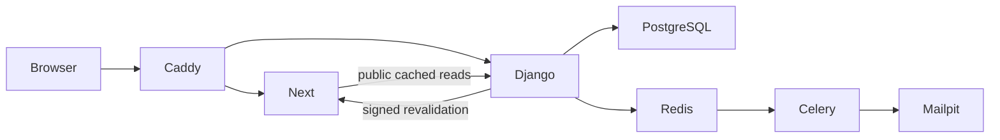

# Architecture

The browser uses one origin, Caddy at localhost:8088. `/api/v1/*` and `/media/*` reach Django:8000; HTML and static assets reach Next:3000. Caddy blocks `/internal/*`; Django calls Next's revalidation endpoint directly with a shared secret. PostgreSQL holds durable state. Redis supplies Celery delivery, caching and atomic rate-limit counters. Mailpit receives local SMTP messages.

Django is a modular monolith: accounts, catalogue, inventory, carts, orders, payments, promotions, content, support, reviews, looks and management. Staff use a custom Persian panel; Django admin is not exposed. Authorization is enforced on every management API method, with unmapped methods denied. Local development defaults to password-only staff login via `MFA_DEV_BYPASS=true`; production requires MFA. Sensitive operations additionally require recent password reauthentication, with TOTP when MFA is enabled.

Money is integer toman. Only `apps/orders/pricing.py` calculates basket totals, discounts and delivery fees. The payment attempt snapshots the toman×10 IRR gateway amount. The shipping threshold uses the discounted subtotal. Browser prices and callback query parameters never establish payment success.

Order creation locks inventory in stable variant order and reserves stock atomically with coupon capacity. Available stock is `on_hand - reserved`, protected by database checks. Settlement consumes a reservation once; expiry/cancellation releases it. Late settlement reacquires stock or moves the order to review. Duplicate payment attempts are flagged. Idempotency keys replay matching commands and reject changed payloads.

Fulfillment progresses `awaiting_payment → processing → packed → shipped → delivered`; unpaid packing and skipped steps are rejected. Refunds require a bounded amount and a real operator reference before completion. Returns validate quantities and restock accepted/received units only. Order items preserve product/price/address snapshots.

Transactional outbox records email and cache invalidation with the business transaction. Worker dispatch and scheduled retries tolerate broker failure. Beat runs reservation expiry, reconciliation and outbox sweeps. Browser payment result pages poll owned server state, never trust the browser return as proof.

Sessions use HttpOnly cookies, CSRF on all unsafe requests including anonymous login/cart, and no bearer tokens in browser storage. Verification/reset/guest-access secrets arrive in URL fragments and are removed after reading. Login/logout reset private query data while retaining active auth observers. Public server responses use tagged Next data caches; builds do not contact the backend.

Next proxy supplies a fresh CSP nonce and private-page noindex/no-store. Development allows evaluation and HMR sockets; production omits them. Inline style attributes remain necessary for color swatches, Motion and photographic layer placement. JSON-LD escapes `<` before insertion. Uploaded rasters are decoded, bounded, re-encoded to WebP and stripped of metadata; HTML/SVG and traversal are rejected.

The studio uses prepared photographic layers on a fixed young model. A trusted version-2 local manifest validates image paths, dimensions, byte budgets and independent horizontal/vertical placement scales and gates compatible product/colour assignments. The customer chooses a complete outfit before requesting its photo. SVG image elements draw registered clothing and one complete head variant; measured vector silhouettes protect the face and reference neck. The same composition plan supplies the ephemeral Canvas2D JPEG exporter. No generation service, Three.js or 3D files are used. A missing image disables preview with an explicit message. Size selection affects the purchasable stock variant rather than body deformation. See STUDIO_IMAGES.md for coverage and registration.

Homepage public content supplies up to 16 unique published picks (featured order first, then catalogue order), five category shortcuts including sunglasses, and a dedicated eyewear list. Client components under `components/home/` provide RTL product scrolling, frame selection and prepared outfit selection. `LookDiscovery` reuses the studio manifest/compositor, decodes a full selection before changing the picture, retains the last result on failure, and passes exact product/colour identifiers into the studio. Outerwear is excluded from the active manifest and slot list; commerce records remain available.
